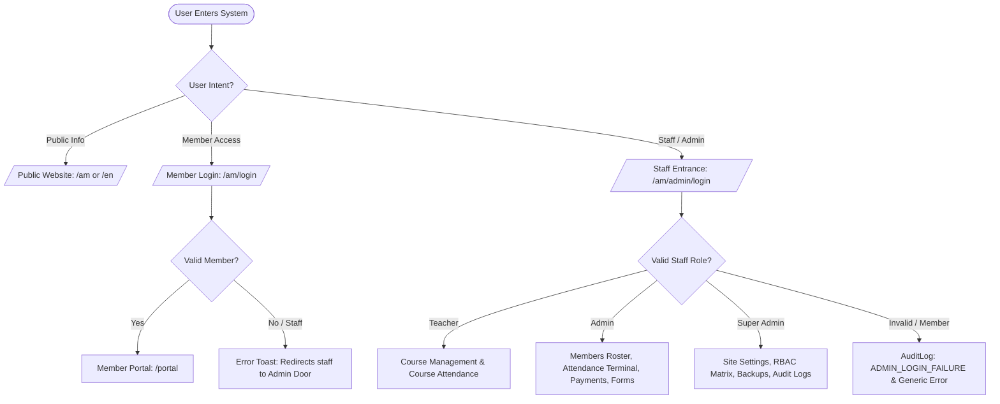
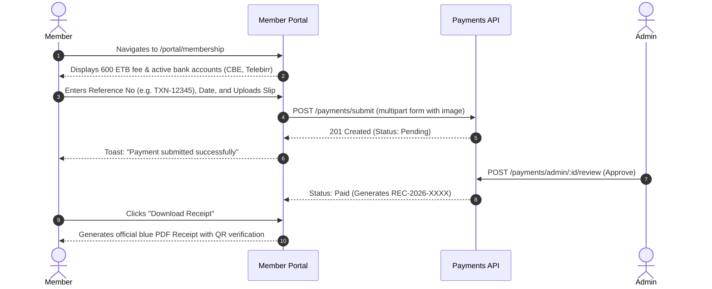
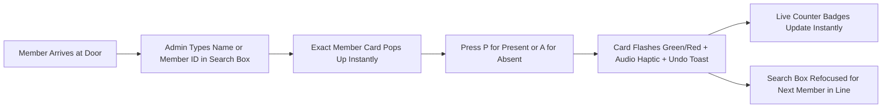

# Felegeselam Kidus Giyorgis Cathedral — Aemade Selam Sunday School System
## Complete Operational Manual & End-to-End Workflow Reference

---

### Table of Contents
1. [System Architecture & Canonical Identity](#1-system-architecture--canonical-identity)
2. [Quick-Start & Environment Setup](#2-quick-start--environment-setup)
3. [User Roles & Security Model](#3-user-roles--security-model)
4. [Public Website Workflows (Visitor Guide)](#4-public-website-workflows-visitor-guide)
5. [Member Portal Workflows (Student/Parishioner Guide)](#5-member-portal-workflows-studentparishioner-guide)
6. [Instructor / Teacher Workflows](#6-instructor--teacher-workflows)
7. [Admin Attendance Terminal Workflow](#7-admin-attendance-terminal-workflow)
8. [Annual Membership Payment Review Workflow](#8-annual-membership-payment-review-workflow)
9. [Member Directory & Registration Workflows](#9-member-directory--registration-workflows)
10. [Super Admin Site Settings & Customization](#10-super-admin-site-settings--customization)
11. [Audit Logging, Security & Disaster Recovery](#11-audit-logging-security--disaster-recovery)

---

### 1. System Architecture & Canonical Identity

The platform is designed exclusively for **Aemade Selam Sunday School (አዕማደ ሰላም ሰንበት ትምህርት ቤት)** under the patronage of **Felegeselam Kidus Giyorgis Cathedral (ፈለገ ሰላም ቅዱስ ጊዮርጊስ ካቴድራል)** in **Finote Selam, West Gojjam, Amhara Region, Ethiopia (ፍኖተ ሰላም፣ ምዕራብ ጎጃም፣ አማራ ክልል፣ ኢትዮጵያ)**.

#### Core Design Principles
* **Dual-Language & Dual-Calendar**: Native Amharic (አማርኛ) and English, running a custom Ethiopian Calendar engine (13 months, Ge'ez numerals, leap year arithmetic) synced with Gregorian calendar.
* **Dual-Door Access**: Separate entry gates for members (`/login`) and administrative staff (`/admin/login`).
* **Single Source of Truth**: System branding, contact information, and hierarchy propagate across web pages, emails, and document exports (PDF, Excel, Word).
* **Color Identity**: Deep Blue (`#0F4C81`), Navy (`#0A2E52`), Soft Blue (`#E8F1FB`), Pure White (`#FFFFFF`), with Gold accents (`#F2B233`) reserved strictly for CTAs and highlights.

---

### 2. Quick-Start & Environment Setup

#### Default Ports & Endpoints
* **Frontend Web Application**: `http://localhost:3001` (Next.js 14)
* **Backend REST API**: `http://localhost:3000/api/v1` (NestJS)
* **Database**: MySQL 8.0 on `localhost:3306` (`felegeselam`)

#### Starting the Platform
```powershell
# 1. Start MySQL (if using local XAMPP)
& "C:\xampp\mysql\bin\mysqld.exe" --defaults-file="C:\xampp\mysql\bin\my.ini" --console

# 2. Start Backend API
cd c:\Users\user\Desktop\PersonalProjects\FelegeSelam\api
npm run start:prod

# 3. Start Frontend Web Server
cd c:\Users\user\Desktop\PersonalProjects\FelegeSelam\web
npm run start
```

#### Pre-Configured Seed Accounts
| Role | Email / Identifier | Password | Access Area |
| :--- | :--- | :--- | :--- |
| **Super Admin** | `admin@aemade.org` | `Admin@123456!` | Full System & Site Settings (`/admin/*`) |
| **Teacher** | `teacher@aemade.org` | `Teacher@123456!` | Courses & Assigned Attendance (`/admin/*`) |
| **Member** | `member@aemade.org` | `Member@123456!` | Member Self-Service Portal (`/portal/*`) |

---

### 3. User Roles & Security Model



1. **Member**: Can view personal data, pay membership fees, view courses, track attendance, and download certificates. Forbidden from administrative routes (HTTP 403).
2. **Teacher**: Instructs courses, enters grades, marks attendance for assigned classes.
3. **Admin**: Manages member rosters, operates Sunday attendance terminal, approves payments, issues ID cards and official certificates.
4. **Super Admin**: Controls site configuration, logos, colors, permissions matrix, database backups, audit logs, and soft-deleted member recovery.

---

### 4. Public Website Workflows (Visitor Guide)

1. **Homepage (`/am` or `/en`)**:
   * **Header Micro-bar**: Displays canonical church affiliation (*Felegeselam Kidus Giyorgis Cathedral, Finote Selam, West Gojjam*).
   * **Hero Section**: Shows Cathedral badge, school logo, welcome heading, and instant registration CTA.
   * **Spiritual Banner**: Shows today's Ethiopian liturgical date and daily Synaxarium (ስንክሳር) saint commemoration.
   * **Language & Theme Toggles**: One-click switch between Amharic and English, and Light/Dark themes.
2. **Liturgical Calendar (`/am/calendar`)**:
   * Interactive Ethiopian liturgical calendar showing the Seven Fasts (ሰባቱ አጽዋማት), Nine Major Feasts, Minor Feasts, and monthly patron saint celebrations.
   * Date Converter: Bi-directional Ethiopian ↔ Gregorian date lookup.
3. **Spiritual Hymns / Mezmur (`/am/mezmur`)**:
   * Searchable audio player categorized by season (St. Mary, St. George, Cross Feast, Fasting).
   * In-line synchronized lyrics display in Ethiopic script.
4. **Certificate Verification Portal (`/am/verify/[code]`)**:
   * Anyone can scan the QR code on a certificate or enter a certificate serial number (e.g., `CERT-2026-XXXX`).
   * Validates recipient name, course completed, graduation date, and official seal status.
5. **Public Member Registration (`/am/register`)**:
   * Form with phone, baptismal name, parish (pre-filled with *ፈለገ ሰላም ቅዱስ ጊዮርጊስ ካቴድራል*).
   * Automatically creates an account in `pending` status awaiting administrative confirmation.

---

### 5. Member Portal Workflows (Student/Parishioner Guide)

Accessible via `/am/login` → redirects to `/am/portal`.

#### 1. Digital Membership ID Card
* Displays photo, full name in Ethiopic script, official Member Number (`AS-2026-XXXX`), department, and verified QR code.
* One-click download of the official high-resolution ID card PDF.

#### 2. Annual Membership Payment (`/am/portal/membership`)


#### 3. Course Enrollment & Academic Progress (`/am/portal/courses`)
* Browse available Sunday School spiritual courses (Orthodox Dogma, Church History, Ge'ez Language, Hymnody).
* Track attendance rate per course, view syllabus lessons, submit assignments, and view teacher remarks.

#### 4. Contributions Ledger (`/am/portal/contributions`)
* Track monthly dues, special church project donations, and pledges with digital voucher copies.

---

### 6. Instructor / Teacher Workflows

Instructors sign in through `/am/admin/login`:
1. **Course Roster**: Open assigned course under `/admin/courses/[id]`.
2. **Attendance Sessions**: Create a class session specifically for their course and record attendance (Present, Absent, Late, Excused).
3. **Grading & Certification**: Enter continuous assessment and final exam grades; approve eligible students for graduation certificates.

---

### 7. Admin Attendance Terminal Workflow

Located at `/am/admin/attendance`. Engineered for rapid Sunday service check-in at church doors.



#### Key Capabilities
* **Instant Keyboard Shortcuts**:
  * `P`: Mark Present (Green)
  * `A`: Mark Absent (Red)
  * `L`: Mark Late (Yellow)
  * `Esc`: Clear search / selection
* **Live Counters**: Real-time tallies for *Present*, *Absent*, *Late*, *Excused*, and *Remaining*.
* **Bulk Operation**: "Mark All Remaining as Absent" button with safety confirmation.
* **Session Integrity**:
  * Closing a session locks records against alterations.
  * Reopening closed sessions is restricted to the **Super Admin** role.
* **Exporting**: Instant download of official attendance session sheets in PDF or Excel with cathedral letterhead.

---

### 8. Annual Membership Payment Review Workflow

Located at `/am/admin/payments`.

1. **Review Queue**:
   * Pending payments appear sorted by submission timestamp.
   * Side-by-side inspection of member details and full-resolution bank slip screenshot.
2. **Approval Action**:
   * Click **Approve**: System issues sequential receipt number (e.g. `REC-2026-0042`), generates official branded PDF receipt, and notifies member.
   * Click **Reject**: Requires entering a reason (e.g. *Duplicate transaction reference* or *Illegible deposit slip*). Member receives immediate explanation on their portal.
3. **Walk-In Cash Payments**:
   * Click **Record Cash Payment**: Admin selects member, inputs amount and date, and issues instant printed receipt.
4. **Delinquency Tracking**:
   * Filter unpaid members for the active Ethiopian calendar year and dispatch bulk reminder notices.

---

### 9. Member Directory & Registration Workflows

Located at `/am/admin/members`.

#### 1. 5-Step Member Registration Stepper
1. **Personal Information**: Full name (First, Father, Grandfather, Baptismal), Sex, Date of Birth (Ethiopian/Gregorian converter), Phone, Email.
2. **Residential Address**: Region, Zone, Woreda, Kebele, House Number / Landmark in Finote Selam.
3. **Church & Parish**: Parish church, Confession Father (የንስሐ አባት), Ministry Department.
4. **Academic & Occupation**: Secular education level, current career or field of study.
5. **Emergency Contacts & Review**: Guardian/Emergency contact details, final verification, and ID generation.

#### 2. Bulk Excel Import & Export
* **Import**: Download standard `.xlsx` template, upload filled roster, view pre-import error validation (flags duplicate phones/emails), and import with one click.
* **Export**: Generate official member rosters in Excel or formatted PDF directories with photos.

---

### 10. Super Admin Site Settings & Customization

Located at `/am/admin/site`. Allows full system customization with **zero code modifications or redeployments**.

```mermaid
graph TD
    Settings[/admin/site Settings Tabs] --> T1[Tab 1: Identity - School & Cathedral Names, Logo, Favicon]
    Settings --> T2[Tab 2: Appearance - Colors, Hero Image, Overlay, Contrast Checker]
    Settings --> T3[Tab 3: Home Content - Welcome Titles, Announcements, Section Orders]
    Settings --> T4[Tab 4: About & Contact - Mission, Vision, Phones, Map Links]
    Settings --> T5[Tab 5: System - Maintenance Mode, Default Locale, IP Allowlist]
    Settings --> T6[Tab 6: Roles & Permissions Matrix]
    Settings --> T7[Tab 7: Danger Zone - Log Purge, Backups, Soft-Delete Restore]

    Settings --> Save[Save Changes]
    Save --> DB[(Setting Table)]
    Save --> History[(SettingVersion Table)]
    Save --> Cache[Invalidate API Public Cache & Next.js Revalidation]
    Cache --> LiveSite[Public Website Updates Immediately]
```

* **Instant Reflection**: Saving invalidates the public settings cache; changes show on the live website immediately.
* **Version History & Rollback**: Every edit creates a timestamped version snapshot with the admin's name. Click **Restore Version** to roll back at any time.
* **WCAG Contrast Calculator**: Built-in real-time color contrast engine flags any combinations failing WCAG AA (4.5:1) or AAA (7:1) readability thresholds.
* **Danger Zone Safeguards**: Destructive actions (database backup download, audit log purge) require typing exact uppercase confirmation phrases.

---

### 11. Audit Logging, Security & Disaster Recovery

#### 1. Immutable Audit Trail (`/admin/audit-logs`)
* Every critical operation is logged:
  * Authentication: Logins, logouts, password resets, and failed staff logins (`ADMIN_LOGIN_FAILURE`).
  * Attendance: Marking, session closures, session re-openings.
  * Finances: Payment approvals, rejections, cash registrations.
  * System: Setting modifications, version rollbacks, database backup downloads.
* Filter logs by Actor, Action Type, Entity ID, Date Range, or IP Address.

#### 2. Backup & Disaster Recovery (`/admin/backups`)
* Generate complete SQL database dumps on demand.
* Download timestamped `.sql` archives for off-site disaster recovery storage.
* Automated database migration files ensure zero data loss across upgrades.
