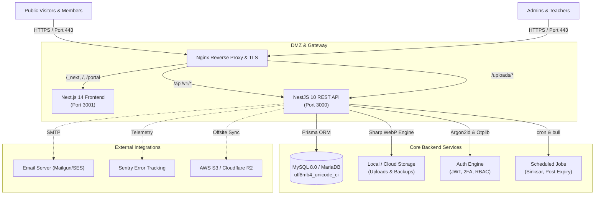
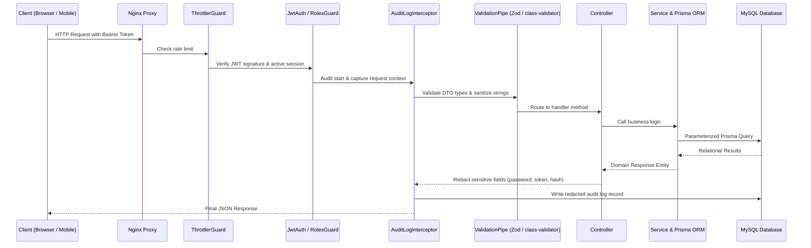

# System Architecture Documentation

> **System**: Aemade Selam Sunday School Management System  
> **Repository**: [FelegeSelam](file:///c:/Users/user/Desktop/PersonalProjects/FelegeSelam)  
> **Date**: October 2026

---

## 1. High-Level Architecture Overview

The Aemade Selam Sunday School Management System is designed as a modular, decoupled full-stack platform consisting of a high-performance **NestJS REST API**, a server-rendered **Next.js 14 Web Application**, a persistent **MySQL 8.0** relational database, and an **Nginx Reverse Proxy** with automated SSL termination.



---

## 2. Technology Stack & Decision Rationale

### 2.1 Backend (`/api`)
- **Framework**: [NestJS 10](https://nestjs.com) — Enterprise-grade TypeScript framework enforcing Clean Architecture, dependency injection, and modular structure.
- **ORM**: [Prisma 5](https://www.prisma.io) — Type-safe relational schema modeling, automated migrations (`prisma migrate deploy`), and parameterized query execution preventing SQL injection.
- **Database**: **MySQL 8.0 / MariaDB 10.4** — Native full-text indexing, utf8mb4 multi-byte Amharic Unicode collation (`utf8mb4_unicode_ci`).
- **Security & Crypto**:
  - `argon2` (Argon2id variant) for salted password hashing.
  - `passport-jwt` with strict single-use refresh token rotation (OWASP RFC 6819).
  - `otplib` for Time-based One-Time Password (TOTP) two-factor authentication.
  - `helmet` for HTTP security headers and Content Security Policy.
- **Media & Document Generation**:
  - `sharp` for high-speed WebP image conversion and thumbnailing.
  - `exceljs` & `xlsx` for bidirectional spreadsheet imports/exports.
  - `puppeteer` for headless rendering of PDF certificates and official letters.

### 2.2 Frontend (`/web`)
- **Framework**: [Next.js 14](https://nextjs.org) (App Router) — Hybrid Server-Side Rendering (SSR) and Client Components with React 18.
- **Internationalization**: `next-intl` providing seamless locale routing (`/am/...` and `/en/...`) with zero runtime layout shifts.
- **Styling & UI**:
  - `Tailwind CSS` with CSS variables for dynamic Dark Mode support.
  - `Lucide React` iconography.
  - `Recharts` for interactive SVG/Canvas administrative analytics.
  - `TipTap` rich text editor for spiritual articles and scheduled notices.
- **Form Handling & Validation**: `react-hook-form` integrated with `zod` schema resolvers.
- **Data Fetching**: `@tanstack/react-query` for client caching, optimistic updates, and background refetching.

---

## 3. Layered Request Lifecycle

Every HTTP request to the NestJS API passes through standard security and validation layers before hitting service logic:



---

## 4. Storage Architecture

```
/app
├── /uploads
│   ├── /photos         # Profile pictures (resized WebP, max 2MB)
│   ├── /lessons        # Lesson materials (PDFs, Audio MP3, Video MP4)
│   ├── /branding       # School logo and public seal
│   └── /posts          # Spiritual article banner attachments
└── /backups            # Gzipped mysqldump files (30-day retention)
```
- Uploaded assets are served statically by Nginx with aggressive caching headers (`Cache-Control: public, max-age=2592000`).
- Database backups are isolated on persistent Docker volumes and periodically synced to cloud storage (S3/R2).
