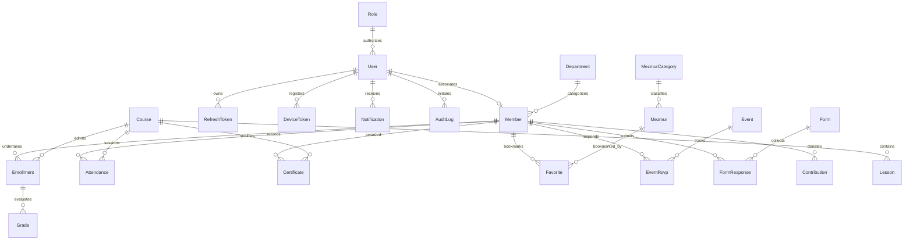

# Database Schema & Entity-Relationship Documentation

## 1. Executive Summary & Engine Configuration

The **Aemade Selam Sunday School Management Platform** utilizes **MySQL 8.0** as its primary relational database management system, mediated by **Prisma ORM**.

- **Database Engine**: MySQL 8.0 (InnoDB)
- **Character Set**: `utf8mb4` (Full Unicode support for Ge'ez / Amharic orthography and emojis)
- **Collation**: `utf8mb4_unicode_ci`
- **Primary Key Strategy**: UUID v4 (`CHAR(36)`) for user-facing domain entities; Auto-increment `INT` for lookup taxonomies (`Role`, `Department`, `MezmurCategory`).
- **Audit Trails**: Full before-and-after JSON snapshots in `audit_logs` tracking changes across members, attendance, grades, and system settings.
- **Migration Policy**: Production deployments strictly execute `prisma migrate deploy` (`npx prisma migrate deploy`). Destruction or reset commands (`prisma migrate reset`, `db push --force-reset`) are prohibited.

---

## 2. Entity-Relationship Diagram (ERD)

---

## 3. Enumerated Types (Enums)

| Enum Name | Possible Values | Usage Domain |
|:---|:---|:---|
| `UserStatus` | `pending`, `active`, `suspended` | User security state & portal lockouts |
| `Sex` | `male`, `female` | Member profile demographic |
| `MemberStatus` | `pending`, `active`, `inactive`, `graduated`, `transferred` | Member lifecycle & directory filtering |
| `CourseStatus` | `draft`, `open`, `closed`, `archived` | Academic curriculum publishing |
| `MediaType` | `text`, `pdf`, `audio`, `video`, `link` | Pedagogical lesson attachments |
| `EnrollmentStatus`| `active`, `completed`, `dropped` | Student course tracking |
| `AttendanceStatus`| `present`, `absent`, `late`, `excused` | Daily classroom attendance |
| `PostType` | `sinksar`, `bible_reading`, `saint_of_day`, `urgent`, `event`, `news`, `teaching` | News & liturgical feed classification |
| `EventRsvpStatus` | `going`, `maybe`, `not_going` | Event seat booking and catering |
| `FormStatus` | `draft`, `open`, `closed` | Dynamic form lifecycle |
| `FormResponseStatus` | `submitted`, `approved`, `rejected` | Workflow application verification |
| `DevicePlatform` | `android`, `ios`, `web` | Push notification device registration |

---

## 4. Detailed Data Dictionary

### 4.1 Authentication & Security (`auth`)

#### `roles`
Stores predefined system roles and JSON permission matrix.
- `id` (INT, PK, Auto-increment)
- `name` (VARCHAR(50), Unique) - e.g. `super_admin`, `admin`, `teacher`, `member`, `content_manager`
- `permissions` (JSON) - Fine-grained access control list
- `createdAt`, `updatedAt` (DATETIME)

#### `users`
System accounts for authentication and portal access.
- `id` (CHAR(36), PK, UUID)
- `email` (VARCHAR(191), Unique, Nullable)
- `phone` (VARCHAR(50), Unique, Nullable)
- `passwordHash` (VARCHAR(255)) - Argon2id / bcrypt hashed password
- `roleId` (INT, FK -> `roles.id`)
- `status` (`UserStatus`, Default: `pending`)
- `twoFactorSecret` (VARCHAR(255), Nullable) - TOTP base32 secret encrypted
- `failedLogins` (INT, Default: 0) - Brute-force lockout counter
- `lockedUntil` (DATETIME, Nullable) - Automatic temporary suspension timer
- `lastLogin` (DATETIME, Nullable)

#### `refresh_tokens`
Cryptographically hashed rotating JWT refresh tokens.
- `id` (CHAR(36), PK, UUID)
- `userId` (CHAR(36), FK -> `users.id`, CASCADE)
- `tokenHash` (VARCHAR(255), Indexed) - SHA-256 hash of refresh token
- `expiresAt` (DATETIME)
- `revoked` (BOOLEAN, Default: false)

---

### 4.2 Member Directory & Governance (`members`)

#### `departments`
Sunday school service sub-divisions (e.g. ኪነጥበብ ክፍል፣ ትምህርት ክፍል፣ ሕፃናት ክፍል).
- `id` (INT, PK, Auto-increment)
- `nameAm` (VARCHAR(100), Unique)
- `nameEn` (VARCHAR(100), Nullable)
- `description` (TEXT, Nullable)

#### `members`
Comprehensive profile and ecclesiastical records.
- `id` (CHAR(36), PK, UUID)
- `memberNo` (VARCHAR(50), Unique) - Human-readable unique code (e.g., `M-0001`)
- `userId` (CHAR(36), FK -> `users.id`, Unique, Nullable, SET NULL)
- `firstName`, `fatherName`, `grandfatherName` (VARCHAR(100))
- `baptismalName` (VARCHAR(100), Nullable) - የክርስትና ስም
- `sex` (`Sex`)
- `dateOfBirth` (DATETIME, Nullable)
- `phone`, `email` (VARCHAR)
- `region`, `zone`, `woreda`, `kebele` (VARCHAR(100), Nullable)
- `addressDetail` (TEXT, Nullable)
- `parish` (VARCHAR(191), Nullable) - የጥምቀት / የደብር ስም
- `confessionFather` (VARCHAR(191), Nullable) - የንስሐ አባት
- `educationLevel`, `occupation` (VARCHAR(100), Nullable)
- `emergencyName`, `emergencyPhone` (VARCHAR, Nullable)
- `departmentId` (INT, FK -> `departments.id`, Nullable, SET NULL)
- `photoUrl` (VARCHAR(500), Nullable)
- `status` (`MemberStatus`, Default: `active`)
- `joinedAt` (DATETIME, Default: NOW)
- `notes` (TEXT, Nullable)
- `deletedAt` (DATETIME, Nullable) - Soft-delete timestamp for compliance
- **Indexes**: `departmentId`, `status`, `phone`, `deletedAt`, Fulltext(`firstName`, `fatherName`, `grandfatherName`, `baptismalName`)

---

### 4.3 Academic Engine (`courses`, `lessons`, `attendance`, `grades`, `certificates`)

#### `courses`
Curriculum subjects and seasonal classes.
- `id` (CHAR(36), PK, UUID)
- `titleAm` (VARCHAR(200)), `titleEn` (VARCHAR(200), Nullable)
- `description` (TEXT, Nullable)
- `level` (VARCHAR(50), Nullable) - e.g. `Beginner`, `Intermediate`, `Advanced`
- `teacherId` (CHAR(36), Nullable)
- `schedule` (VARCHAR(200), Nullable) - e.g. `ቅዳሜ 8:00 - 10:00`
- `capacity` (INT, Nullable)
- `startDate`, `endDate` (DATETIME, Nullable)
- `status` (`CourseStatus`, Default: `draft`)

#### `lessons`
Individual syllabus lessons, media, and learning materials.
- `id` (CHAR(36), PK, UUID)
- `courseId` (CHAR(36), FK -> `courses.id`, CASCADE)
- `title` (VARCHAR(200))
- `content` (LONGTEXT, Nullable)
- `mediaType` (`MediaType`, Default: `text`)
- `fileUrl` (VARCHAR(500), Nullable)
- `orderNo` (INT, Default: 1)
- `published` (BOOLEAN, Default: false)

#### `enrollments`
Student registration in courses.
- `id` (CHAR(36), PK, UUID)
- `memberId` (CHAR(36), FK -> `members.id`, CASCADE)
- `courseId` (CHAR(36), FK -> `courses.id`, CASCADE)
- `status` (`EnrollmentStatus`, Default: `active`)
- **Unique Constraint**: `(memberId, courseId)`

#### `attendances`
Daily roll-call records per session.
- `id` (CHAR(36), PK, UUID)
- `memberId` (CHAR(36), FK -> `members.id`, CASCADE)
- `courseId` (CHAR(36), FK -> `courses.id`, CASCADE)
- `sessionDate` (DATE)
- `status` (`AttendanceStatus`, Default: `present`)
- `markedBy` (CHAR(36), Nullable)
- **Unique Constraint**: `(memberId, courseId, sessionDate)`

#### `grades`
Assessment scores and teacher remarks.
- `id` (CHAR(36), PK, UUID)
- `enrollmentId` (CHAR(36), FK -> `enrollments.id`, CASCADE)
- `assessment` (VARCHAR(100)) - e.g. `Midterm`, `Assignment 1`, `Final Exam`
- `score` (FLOAT), `maxScore` (FLOAT, Default: 100)
- `remark` (VARCHAR(255), Nullable)

#### `certificates`
Cryptographically verifiable completion certificates with QR verification.
- `id` (CHAR(36), PK, UUID)
- `memberId` (CHAR(36), FK -> `members.id`, CASCADE)
- `courseId` (CHAR(36), FK -> `courses.id`, CASCADE)
- `code` (VARCHAR(100), Unique) - e.g. `CERT-2026-F981C`
- `issuedAt` (DATETIME, Default: NOW)

---

### 4.4 Mezmur Hymnology & Liturgical Content (`mezmur`, `posts`, `events`)

#### `mezmurs`
Hymn lyrics, audio files, YouTube links, and classifications.
- `id` (CHAR(36), PK, UUID)
- `title` (VARCHAR(255))
- `lyrics` (LONGTEXT, Nullable)
- `categoryId` (INT, FK -> `mezmur_categories.id`, Nullable, SET NULL)
- `singer` (VARCHAR(150), Nullable)
- `audioUrl` (VARCHAR(500), Nullable)
- `videoUrl` (VARCHAR(500), Nullable)
- `isPublic` (BOOLEAN, Default: true)
- **Indexes**: Fulltext(`title`, `lyrics`)

#### `posts`
News, announcements, daily Sinksar, and scripture readings.
- `id` (CHAR(36), PK, UUID)
- `type` (`PostType`, Default: `news`)
- `title` (VARCHAR(255))
- `body` (LONGTEXT) - Sanitized rich HTML
- `imageUrl` (VARCHAR(500), Nullable)
- `isUrgent` (BOOLEAN, Default: false)
- `publishAt` (DATETIME, Default: NOW)
- `expiresAt` (DATETIME, Nullable)
- `authorId` (CHAR(36), Nullable)

#### `events` & `event_rsvps`
Community gatherings, spiritual trips, and RSVP reservations.
- `id` (CHAR(36), PK, UUID)
- `title` (VARCHAR(255)), `description` (TEXT), `location` (VARCHAR(255))
- `startAt` (DATETIME), `endAt` (DATETIME, Nullable)
- `capacity` (INT, Nullable)
- RSVPs link `(eventId, memberId)` with `status` (`going`, `maybe`, `not_going`).

---

### 4.5 Dynamic Form Engine (`forms`, `form_responses`)

#### `forms`
Custom surveys, service registrations, and questionnaire schemas.
- `id` (CHAR(36), PK, UUID)
- `title` (VARCHAR(255)), `description` (TEXT, Nullable)
- `formSchema` (JSON) - Array of dynamic field definitions (text, select, date, file)
- `status` (`FormStatus`, Default: `draft`)
- `openUntil` (DATETIME, Nullable)
- `allowOneResponsePerMember` (BOOLEAN, Default: false)

#### `form_responses`
Submitted answers and administrative approval workflow.
- `id` (CHAR(36), PK, UUID)
- `formId` (CHAR(36), FK -> `forms.id`, CASCADE)
- `memberId` (CHAR(36), FK -> `members.id`, Nullable, SET NULL)
- `answers` (JSON) - Key-value pair response map
- `status` (`FormResponseStatus`, Default: `submitted`)
- `reviewNote` (TEXT, Nullable)
- `reviewedBy` (CHAR(36), Nullable)

---

### 4.6 Financial Contributions & System Operations

#### `contributions`
Tithe, building funds, and membership fee payments.
- `id` (CHAR(36), PK, UUID)
- `memberId` (CHAR(36), FK -> `members.id`, CASCADE)
- `amount` (DECIMAL(12,2)) - Exact currency calculation
- `type` (VARCHAR(50)) - e.g. `monthly_due`, `donation`, `building_fund`
- `paymentMethod` (VARCHAR(50)) - e.g. `CBE`, `Telebirr`, `cash`
- `period` (VARCHAR(50), Nullable) - e.g. `2026-10`
- `receiptNo` (VARCHAR(100), Unique, Nullable)
- `paidAt` (DATETIME, Default: NOW)
- `recordedBy` (CHAR(36), Nullable)

#### `audit_logs`
Tamper-resistant operational tracking for compliance and dispute resolution.
- `id` (CHAR(36), PK, UUID)
- `userId` (CHAR(36), FK -> `users.id`, Nullable, SET NULL)
- `action` (VARCHAR(100)) - e.g. `UPDATE`, `CREATE`, `DELETE`, `LOGIN`
- `entity` (VARCHAR(100)) - e.g. `Member`, `Grade`, `Contribution`
- `entityId` (VARCHAR(100), Nullable)
- `oldValue` (JSON, Nullable)
- `newValue` (JSON, Nullable)
- `ip` (VARCHAR(50), Nullable)
- `createdAt` (DATETIME, Default: NOW)

#### `settings`
System-wide key-value preferences (Bilingual school branding, contact info, calendar config).
- `settingKey` (VARCHAR(100), PK)
- `settingValue` (JSON)
- `updatedAt` (DATETIME)
